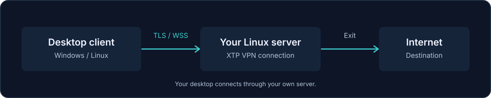

<p align="center">
  <picture>
    <source media="(max-width: 600px)" srcset="docs/assets/xantum-banner-compact.svg">
    
  </picture>
</p>

<p align="center"><strong>Kendi Linux sunucunda çalışan VPN, masaüstünde sohbet ve ses.</strong><br>Windows ve Linux için tek proje. XTP ile yönetebildiğin bir bağlantı altyapısı.</p>

<p align="center">
  <a href="docs/KURULUM.md"></a>
  <a href="docs/WIKI.md"></a>
  <a href="https://github.com/sayrias/VPN-App/releases"></a>
  <a href="https://github.com/sayrias/VPN-App/issues"></a>
</p>

<p align="center"><a href="docs/BUILDING.md">Kaynak koddan derle</a> · <a href="docs/SISTEM.md">Mimari</a> · <a href="docs/GELISTIRME-PLANI.md">Geliştirme planı</a></p>

> **v1.0.0 geliştirme aşamasında.** Windows ve Linux doğrulama işleri [geliştirme planında](docs/GELISTIRME-PLANI.md) izlenir.

## Xantum ile

**Bağlantını kendi sunucundan geçir.** XTP, işletim sisteminin sanal ağ adaptöründeki IP paketlerini WebSocket üzerinden taşır; uzak bağlantılar doğrulanmış TLS kullanır. İlk sürüm tam tünel kullanımına odaklanır. WireGuard protokolü veya kurulumu gerekmez. Windows sanal adaptörü için Wintun kullanılır.

**Aynı sunucuda buluş.** Kimlik doğrulamalı sohbet, sunucu teslim onayları ve oturumluk mesaj geçmişi bulunur. En fazla 8 kişilik ses odası WebRTC ile çalışır; mikrofon kazancı, gürültü kapısı ve uygulama odaklı bas-konuş ayarlanabilir.

**Bağlantını bir kez hazırla.** Genel pakette adres ve katılım anahtarını Ayarlar → Sunucun bölümüne kaydet. Kendi sunucuna özel paket için derleme sihirbazından **Hazır bağlantı** seç; uygulama bilgiler hazır açılır. Özel paket anahtarı içerir ve yalnız güvendiğin kişilerle paylaşılmalıdır.

**Bağlantı kesilince korumayı sürdür.** Tam tünel için DNS yönlendirmesi, IPv6 çıkış engeli ve beklenmedik kesintide trafik kilidi uygulanır. Uygulama kilidin durumunu gösterir; yeniden bağlanabilir veya “İnterneti geri aç” ile korumayı kaldırabilirsin. [Koruma kapsamı, istisnalar ve platform testleri →](docs/NETWORK-PROTECTION.md)

<p align="center">
  <picture>
    <source media="(max-width: 600px)" srcset="docs/assets/xtp-flow-compact.svg">
    
  </picture>
</p>

### Uygulamadan bir görünüm

<p align="center"></p>

Yerel test sunucusu ve örnek kullanıcılarla alınmış geliştirme önizlemesi. Ekrandaki bağlantı durumu gerçek VPN sızıntı testinin kanıtı değildir.

### Koruma kapsamını bil

TLS, istemci ile VPN sunucusu arasındaki aktarımı korur. Sunucudan hedef servise giden bağlantının güvenliği hedef uygulamanın HTTPS gibi kendi protokolüne de bağlıdır. Sohbet sunucusu mesajları görebilir; sohbet uçtan uca şifreli değildir. Özel XTP protokolü bağımsız güvenlik incelemesinden geçmedi.

Ses bağlantıları WebRTC'nin şifreli medya kanallarını kullanır. Farklı NAT/CGNAT ağları için kendi STUN/TURN sunucun gerekebilir; her ağda doğrudan ses bağlantısı garanti edilmez. DNS, IPv6 ve kesinti davranışı [koruma belgesinde](docs/NETWORK-PROTECTION.md) açıklanır.

## Başlangıç rotası

| Yapmak istediğin | Açılacak rehber |
| --- | --- |
| Kendi VPS'ime Xantum sunucusu kuracağım | [TLS, portlar ve sunucu kurulumu](docs/KURULUM.md) |
| Windows veya Linux istemcisini derleyeceğim | [Gerekenler ve paketleme](docs/BUILDING.md) |
| Projenin nasıl çalıştığını anlayacağım | [XTP, sohbet ve ses mimarisi](docs/SISTEM.md) |
| Bir sorunla karşılaştım | [Wiki: bağlantı, sohbet ve ses sorunları](docs/WIKI.md#sorun-giderme) |
| Tamamlananları ve sıradaki işleri göreceğim | [Geliştirme planı](docs/GELISTIRME-PLANI.md) |

## Yerel geliştirme

Sunucu kurmak için proje dizininde `bash xantum.sh` çalıştırıp **1** seçeneğini kullan. IP adresi ve SSH bilgileri yeterlidir; otomatik sertifika seçeneğinde TLS dosyası yolu sorulmaz. Sağlayıcı panelinde TCP 80, 51821 ve 8443 açık olmalı. [Adım adım kolay kurulum →](docs/KURULUM.md#kolay-kurulum-ip--ssh-yeterli)

Node.js 22.12+, npm; Linux TUN yardımcısını derlemek için GCC gerekir.

```bash
git clone https://github.com/sayrias/VPN-App.git
cd VPN-App
npm ci --prefix client
npm ci --prefix server/xantum-server/backend
npm run dev:ui --prefix client
```

Bu komut tarayıcıda arayüzü açar. Electron ile çalıştırmak için:

```bash
npm run dev --prefix client
```

Sunucu ayarlarını kaydetmek ve VPN'e bağlanmak Electron gerektirir. Gerçek bağlantı ayrıca derlenmiş yerel yardımcı, işletim sistemi yetkisi ve TLS yapılandırılmış bir sunucu ister. Sunucuyu hazırlamak için [kurulum rehberini](docs/KURULUM.md), istemci paketleri için [derleme rehberini](docs/BUILDING.md) izle.

### Kaynak doğrulaması

```bash
npm test --prefix client
npm test --prefix development/selective-vpn
npm run build:ui --prefix client
```

Testler localhost portları açar. XTP entegrasyon testleri gerçek WebSocket ve şifreleme kullanırken TUN ve rota değişikliklerini taklit eder; bilgisayarın ağ ayarlarını değiştirmez. Testlerin geçmesi gerçek cihazda sızıntısız VPN kanıtı değildir. CI kaynak doğrulaması [Verify source](.github/workflows/verify.yml) iş akışındadır.

## Sonraki büyük sürüm: seçmeli VPN

Sadece eklediğin uygulama veya siteleri VPN'e yönlendirme hedefi [ayrı geliştirme alanında](development/selective-vpn/README.md) hazırlanıyor. Testli politika motoru ve deneysel TLS CONNECT aktarımı bulunur. Windows/Linux trafik yakalama katmanları henüz uygulanmadı; bu çalışma mevcut uygulamaya bağlı değildir.

[Ürün davranışı, teknik aşamalar ve kabul koşullarını incele →](development/selective-vpn/PLAN.md)

## Projede nerede ne var?

```text
client/                         Electron + React masaüstü istemcisi
client/electron/                XTP motoru, bağlantı ayarları ve IPC
client/native/                  Windows Wintun ve Linux ağ koruması
server/xantum-server/backend/   Güncel API, sohbet ve XTP sunucusu
server/xantum-server/xtp-tun.c  Linux TUN yardımcısı
scripts/                        Derleme ve kurulum araçları
tests/                          v1 davranış ve entegrasyon testleri
development/                    Gelecek sürümlerin geliştirme alanı
docs/                           Wiki, kurulum, mimari ve geliştirme planı
```

`server/backend` ve `server/scripts`, önceki WireGuard tabanlı kaynaktır; güncel kurulumda kullanılmaz. Yeni sunucu geliştirmeleri `server/xantum-server/backend` altında yapılır.

## Katkı ve geri bildirim

[Bir hata kaydı açarken](https://github.com/sayrias/VPN-App/issues) işletim sistemini, uygulama sürümünü, beklediğin davranışı ve sorunu tekrarlama adımlarını paylaş. Ağ sorunlarında bağlantının hangi aşamada durduğunu yaz. Katılım anahtarını, `.env` dosyasını, TLS özel anahtarlarını veya kişisel verilerini yayımlama.

Kaynak kodun kök proje lisansı henüz belirlenmedi; bu depoda belirli bir açık kaynak lisansı varsayılmaz. Wintun gibi üçüncü taraf bileşenlerin kendi lisansları ayrıca geçerlidir.

<p align="center"><a href="docs/WIKI.md">Wiki</a> · <a href="docs/GELISTIRME-PLANI.md">Geliştirme planı</a> · <a href="https://github.com/sayrias/VPN-App/issues">Hata / Öneri</a></p>
