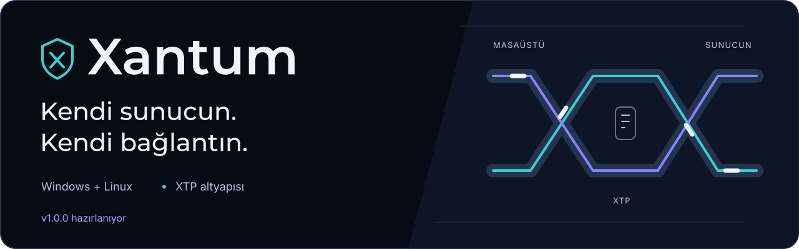
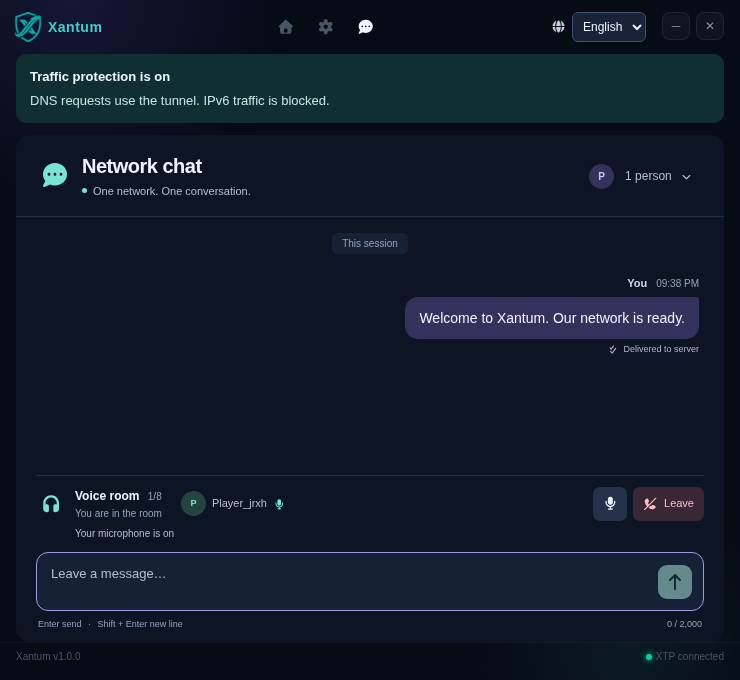

<p align="center">
  <picture>
    <source media="(max-width: 600px)" srcset="docs/assets/xantum-banner-compact.svg">
    
  </picture>
</p>

<p align="center"><strong>A self-hosted VPN with chat and voice, for Windows and Linux.</strong><br>Connect through your own Linux server using XTP. No WireGuard installation required.</p>

<p align="center">
  <a href="docs/SETUP.md"></a>
  <a href="docs/WIKI.md"></a>
  <a href="https://github.com/sayrias/Xantum/releases"></a>
  <a href="https://github.com/sayrias/Xantum/issues"></a>
</p>

## What you get

- **Your own VPN server.** Route system IPv4 traffic through a Linux VPS over verified TLS. Windows uses Wintun as its virtual adapter.
- **Connection protection.** DNS routing, blocked external IPv6 traffic and a traffic lock after an unexpected disconnection. [Protection and recovery](docs/NETWORK-PROTECTION.md).
- **Chat and voice.** Authenticated messaging, delivery acknowledgements and voice rooms for up to eight people.
- **Two package options.** A public installer with no server credentials, or a private package with your connection already configured.

<p align="center"></p>

## Get started

Clone the project and open the setup menu:

```bash
git clone https://github.com/sayrias/Xantum.git
cd Xantum
bash xantum.sh
```

1. Choose **1** to install the server. Enter your VPS address and SSH details; automatic TLS does not ask for certificate paths.
2. Choose **2** to build a Windows or Linux client, or check [Downloads](https://github.com/sayrias/Xantum/releases).
3. In the app, save the server address and access key under **Settings → Your server**, then connect.

The VPS needs TUN support, sudo access and incoming TCP **80**, **51821** and **8443**. See [Setup](docs/SETUP.md) for details and [Building](docs/BUILDING.md) for client requirements.

## Privacy and limits

TLS protects traffic between your device and your VPN server. Protection beyond that server depends on the destination protocol, such as HTTPS. Chat is not end-to-end encrypted; the server can read messages. Voice uses encrypted WebRTC media and may need your own STUN/TURN service on different networks.

XTP has not received an independent security audit. IPv6 is blocked rather than tunneled, and app-specific routing is not available in the desktop client. Read the [protection guide](docs/NETWORK-PROTECTION.md) before relying on it.

[Wiki](docs/WIKI.md) · [Setup](docs/SETUP.md) · [Build from source](docs/BUILDING.md) · [Report a problem](https://github.com/sayrias/Xantum/issues)

Keep access keys, private connection packages, `.env` files and TLS private keys out of public uploads. No root project license has been selected; third-party components retain their own licenses.
