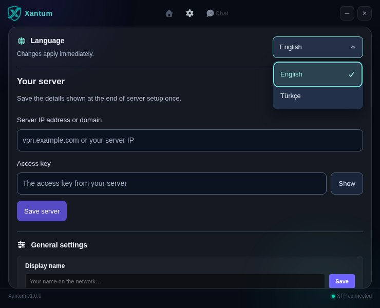

# Setup

Install the server on a Linux VPS; run the desktop client on Windows or Linux.

## Requirements

- Ubuntu 22.04+ or Debian 12+ with systemd, `/dev/net/tun`, IPv4 forwarding/NAT and sudo access.
- SSH access and incoming TCP **80**, **51821** and **8443** allowed in the provider firewall. Keep your SSH port open.
- A public IPv4 address or a domain pointing to the VPS. A domain is optional.

## Install the server

From the project folder on your computer:

```bash
bash xantum.sh
```

Choose **1**, enter the VPS address, SSH username and port, then keep the automatic certificate option. Confirm the SSH host fingerprint and enter your SSH/sudo password if asked. You do not need certificate file paths.

On Windows, `server/xantum-server/deploy-to-vps.bat` opens the same wizard through PowerShell. OpenSSH and `tar` must be available.

The installer prepares the required dependencies, obtains a Let's Encrypt certificate and installs the Xantum service. It displays the **server address** and complete **access key** on separate lines. Save both privately.

Automatic renewal is checked every four hours. **TCP 80 must remain reachable**, including when using an IP certificate. If Nginx already uses port 80, the installer checks its existing webroot and uses it for HTTP validation; it does not stop Nginx or rewrite its sites.

## Connect a client

Use a package from [Downloads](https://github.com/sayrias/Xantum/releases) or follow [Building](BUILDING.md).

1. Open **Settings → Your server**.
2. Enter the server address and access key printed by the installer.
3. Save, return to the home screen and connect.

The app starts in English. Open **Settings → Language** to switch between English and Türkçe instantly; your choice is saved.



A private preconfigured package already contains these details. Share it only with people you authorize.

Linux asks for administrator approval to install missing helpers and manage the tunnel. Do not run Electron as root. Windows requires administrator privileges.

## Check or update the server

Run the same setup wizard to update. The existing key and custom ports are retained; if the replacement service fails its health check, the installer restores the previous installation.

On the VPS:

```bash
sudo systemctl status xantum-backend
sudo journalctl -u xantum-backend -f
sudo systemctl list-timers xantum-certificate.timer
curl --fail https://YOUR_SERVER:51821/health
```

Replace `YOUR_SERVER` with the address on the certificate. Never include the access key or private TLS key in a public issue.

## Change the access key

The standard installer stores the server key as `VPN_PIN` in `/opt/xantum-backend/.env`. Server updates preserve it; rerunning setup does not rotate it.

Disconnect clients first. On the VPS, generate a new random key and edit the configuration:

```bash
openssl rand -hex 24
sudo nano /opt/xantum-backend/.env
```

Replace the existing `VPN_PIN=...` value with the generated key, keeping one `VPN_PIN` entry and the other settings unchanged. Save the file, then restart the service:

```bash
sudo systemctl restart xantum-backend
sudo systemctl is-active xantum-backend
```

The restart disconnects VPN, chat and voice sessions and discards in-memory chat state. Use **restart** for a key change; **reload** refreshes TLS certificates only.

In each client, disconnect and release any retained protection, then open **Settings → Your server → Edit connection**, enter the new access key and save. Rebuild any private preconfigured packages with the new key. Update any private local copies of the old configuration too.

If a key was committed publicly, treat it as exposed even after deleting the file. Changing the server key invalidates the old credential; deleting files or publishing a new release alone does not.

## TLS troubleshooting

If certificate validation fails, check incoming TCP 80 and domain A/AAAA records. The existing HTTP site must serve `/.well-known/acme-challenge/` files without redirects or an application fallback. A known stable webroot can be supplied from your computer:

```bash
XANTUM_ACME_WEBROOT=/var/www/site bash scripts/setup-server.sh
```

This directory is checked over HTTP too. Keep it available for renewals; rerun setup after moving the site or changing its routing.

To use an existing certificate, select that option in the wizard and provide its absolute VPS paths, for example `fullchain.pem` and `privkey.pem` under `/etc/letsencrypt/live/your-domain/`. The certificate must be trusted, match the server address and match the private key. After renewing it yourself, run:

```bash
sudo systemctl reload xantum-backend
```

## Voice across networks

Voice uses WebRTC. Clients behind different NAT/CGNAT networks may require your own STUN/TURN server. Set `ICE_SERVERS` in `/opt/xantum-backend/.env` to a WebRTC-compatible JSON array and restart the backend. No external STUN server is enabled by default. Do not embed long-lived TURN credentials in public packages.

## Custom ports

Default API/chat and XTP ports are **51821/TCP** and **8443/TCP**. Set `API_PORT` and `XTP_PORT` on the VPS before running `setup.sh` to use different ports. The client currently needs matching `apiUrl` and `xtpUrl` values in its private `server.json` under the application data directory. Both URLs must use the same hostname and verified HTTPS/WSS.

If the tunnel fails, reconnect or use **Restore internet access**. See [Protection and recovery](NETWORK-PROTECTION.md) and the [Wiki](WIKI.md).
